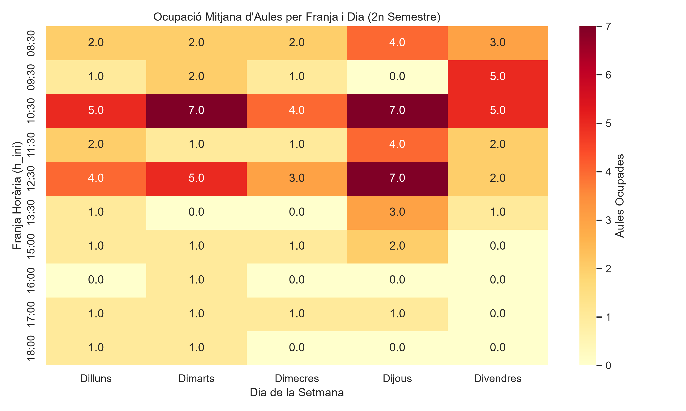
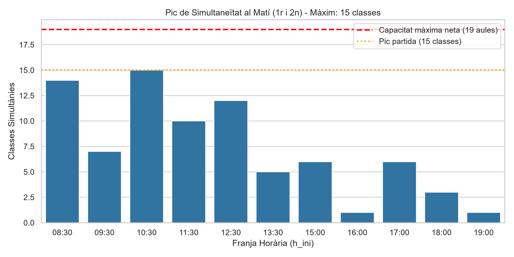
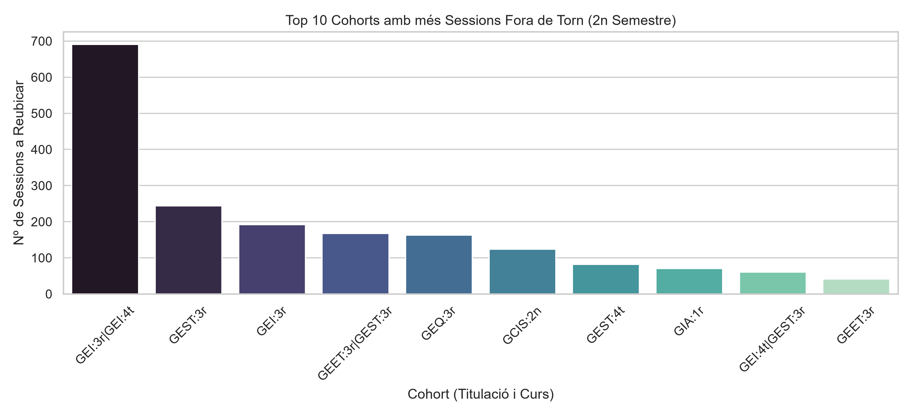
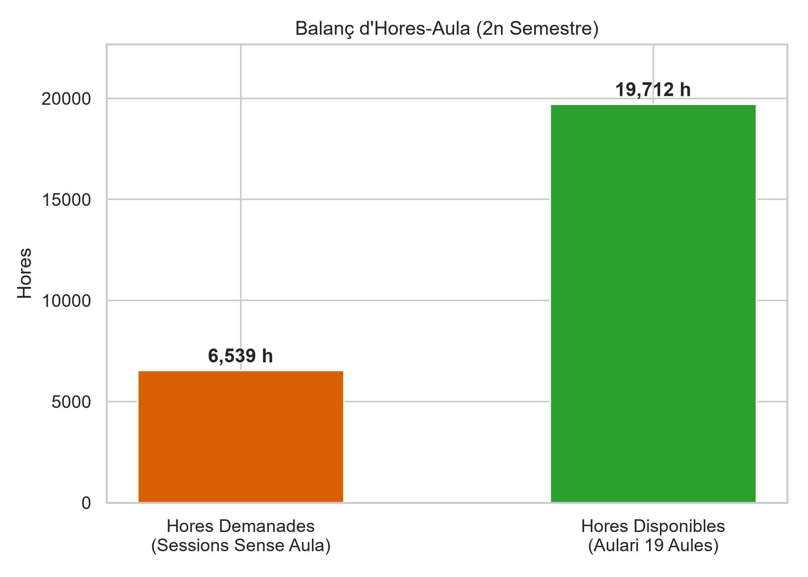
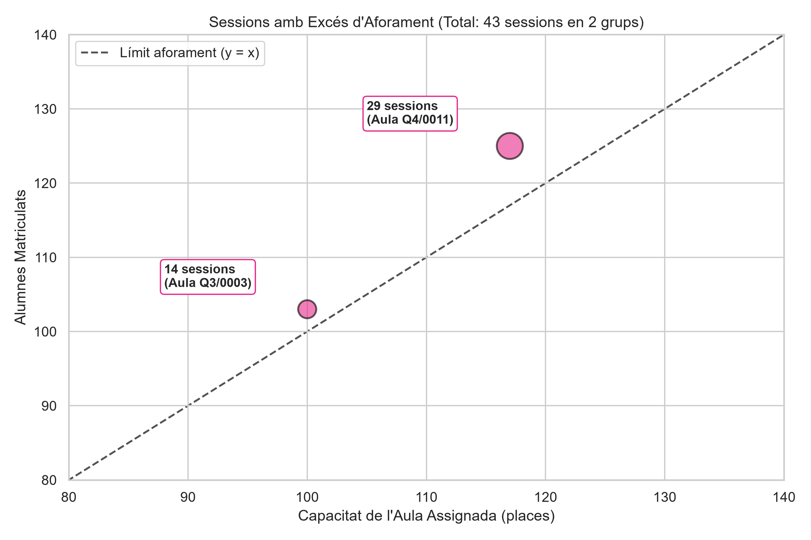

# 404:Brain Cells — Reto de horarios y espacios

Propuesta del equipo **404:Brain Cells** para el reto de la Escuela de Ingeniería de la UAB (UAB THE HACK! 2026). Analizamos la ocupación de los espacios y preparamos propuestas de asignación de aulas y horarios para el segundo semestre.


Actualmente, en la Escuela de Ingeniería de la UAB los espacios se utilizan de diversas formas, principalmente para realizar sesiones de clases, problemas o seminarios. Además, también hay aulas de laboratorio específicas.
Al analizar los horarios, la disponibilidad y la ocupación, se determina que se da más uso a las aulas por la mañana que por la tarde; en consecuencia, se genera un problema de alta ocupación por las mañanas y demasiado espacio libre en la franja de tarde.
Debido a este problema, se ha creado un modelo nuevo con el que se intenta distribuir los horarios de forma que los cursos de primer y segundo año de carrera sean por la mañana y las clases de tercero, cuarto y quinto sean por la tarde, a excepción de los dobles grados y los másteres, que siempre son por la tarde.


## Análisis de los datos

Las figuras de esta sección describen la **situación de partida** y ayudan a identificar los cuellos de botella antes de generar una propuesta nueva.

### 1. Ocupación por día y franja

El mapa muestra la ocupación mediana de las aulas para cada día y franja: los tonos más oscuros indican más aulas ocupadas. Destacan el martes a las 10:30 y el jueves a las 10:30 y a las 12:30. A partir de las 13:30, la ocupación cae de forma marcada.



### 2. Pico de simultaneidad por la mañana

La gráfica se centra en las clases de 1.º y 2.º. Hay muchas clases simultáneas a las 8:30 y, sobre todo, a las 10:30, cuando se alcanza el máximo de **15 clases**. En cambio, la tarde aparece casi vacía. La línea de 19 aulas representa la capacidad neta tras reservar dos de las 21 aulas ordinarias.



### 3. Cohortes con más sesiones fuera del turno previsto

La comparación toma la hora de inicio de cada sesión en el horario actual y la contrasta con el turno asignado en el nuevo modelo; después cuenta las sesiones que quedan fuera de turno por titulación y curso. GEI de 3.º y 4.º es la cohorte más desajustada, por delante de las siguientes del ranking.



### 4. Balance de horas-aula

En el segundo semestre, las sesiones que no tenían aula asignada suman **6.539 horas-aula**, frente a **19.712 horas** disponibles en las 19 aulas ordinarias. El total disponible supera la demanda, pero las horas no están repartidas de manera uniforme: la mañana concentra la demanda y tiene picos de hasta 15 clases simultáneas, mientras que buena parte de la tarde queda desaprovechada. Por eso el balance global no elimina los cuellos de botella de franjas concretas.



### 5. Exceso de aforo en el horario de partida

Cada punto compara la capacidad del aula asignada (eje horizontal) con el número de estudiantes matriculados (eje vertical). Los puntos situados sobre o por debajo de la diagonal caben en el aula; los que quedan por encima indican exceso de aforo. Se observan **43 sesiones afectadas en dos grupos**: 29 en Q4/0011 y 14 en Q3/0003.



## Propuestas del reto

| Punto | Objetivo | Script y salida principal |
| --- | --- | --- |
| 5.1 | Asignar aulas en el segundo semestre sin cambiar días ni horas | `solucio_5_1.py` → `proposta-aules.csv` |
| 5.2 | Reorganizar los turnos y optimizar el horario | `solucio_5_2.py` → `proposta-torns.csv` |
| 5.3 | Adaptar la propuesta al escenario de imprevistos | `solucio_5_3.py` → `proposta-imprevist.csv` |
| 5.4 | Incorporar el nuevo grado de 40 plazas | `solucions_5_4.py` → `proposta-grau-nou.csv` |


## Excepciones y relajaciones

Las excepciones declaradas se guardan en archivos CSV. Cada registro indica la restricción afectada, las sesiones implicadas y la justificación correspondiente.

### Punto 5.2

El archivo `relaxacions-5_2.csv` registra una relajación de la restricción `R1-TORN`.

- Sesiones afectadas: 4.749.
- Motivo: las sesiones se mantienen en su turno de origen para garantizar que no se produzcan solapamientos.

### Punto 5.3

El archivo `relaxacions-imprevist.csv` incorpora la relajación heredada del punto 5.2 y las nuevas excepciones necesarias para el escenario de imprevistos:

- `R1-TORN`: 4.749 sesiones heredadas de la propuesta 5.2.
- `R1-FIXADA`: 8 sesiones evacuadas de un aula cerrada, manteniendo su día y hora.
- `R7-PLAB`: 2 sesiones PLAB trasladadas debido a la reserva del aula `Q3/0013`.

### Punto 5.4

El punto 5.4 reutiliza por defecto el archivo `relaxacions-5_2.csv`. Si fuera necesario, puede utilizarse otro archivo de relajaciones mediante el parámetro `--relaxacions`.


El repositorio también contiene el análisis, el verificador del reto en `horaris/`, los datos de entrada en `paquet/` y archivos auxiliares con propuestas e informes. Consulta [`paquet/DICCIONARI.md`](paquet/DICCIONARI.md) para conocer las columnas y las limitaciones de los datos.

## Ejecución

Ejecuta los comandos desde la raíz del repositorio. Se necesita Python 3.10 o superior. El verificador solo usa la biblioteca estándar; los scripts de solución necesitan `pandas`.

## Ejecución

Ejecuta los comandos desde la raíz del repositorio. Se necesita Python 3.10 o superior.

```powershell
# Comprobar la propuesta de partida
python -m horaris check paquet/proposta_partida.csv --semestre 2 --nomes-aules

# Punto 5.1: generar y validar la asignación de aulas
python solucio_5_1.py

python -m horaris check proposta-aules.csv `
  --semestre 2 `
  --nomes-aules `
  --json informe-5_1.json `
  --violacions violacions-5_1.csv

# Punto 5.2: generar y validar la reorganización de turnos
python solucio_5_2.py

python -m horaris check proposta-torns.csv `
  --semestre 2 `
  --relaxacions relaxacions-5_2.csv `
  --json informe-5_2.json `
  --violacions violacions-5_2.csv

# Punto 5.3: generar y validar el escenario de imprevistos
python solucio_5_3.py --base proposta-torns.csv --check

# Punto 5.4: generar y validar la incorporación del nuevo grado
python solucions_5_4.py proposta-torns.csv `
  --out proposta-grau-nou.csv `
  --check

La comprobación principal es el **veredicto del verificador**, no una estimación de puntuación. El informe puede mostrar incumplimientos heredados del horario de partida; estos no cuentan como incumplimientos nuevos de la propuesta.

## Datos y uso responsable

Los datos del paquete están seudonimizados, pero no son anónimos. Se usan únicamente para este reto: no intentes identificar a ninguna persona ni publiques o compartas los datos fuera del contexto autorizado de la hackatón.

## Equipo

**404:Brain Cells** · UAB THE HACK! 2026
